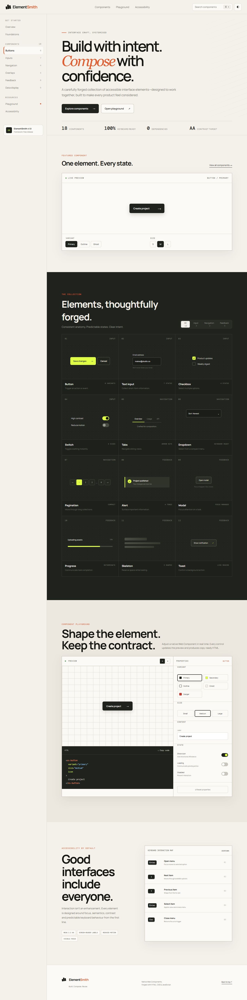

# ElementSmith — Build. Compose. Reuse.



[](https://github.com/ayosomo/elementsmith/actions/workflows/ci.yml)
[](./LICENSE)
[](https://developer.mozilla.org/docs/Web/JavaScript)

ElementSmith is an accessible interface system and interactive component playground built with semantic HTML, modern CSS, vanilla JavaScript and native Web Components.

| | |
| --- | --- |
| **Live demo** | [Open ElementSmith](https://ayosomo.github.io/elementsmith/) |
| **Stack** | Semantic HTML, modern CSS, JavaScript, Web Components, Vite |
| **Tests** | Node test runner, ESLint, production build verification |
| **Deployment** | GitHub Pages, gated by GitHub Actions |

This is an independent portfolio project created as part of my professional transition into frontend development. Its purpose is to demonstrate that high-quality interface engineering is about more than visual polish: it also requires clear APIs, predictable state, accessibility, maintainability and deliberate technical decisions.

## Why this project exists

Many portfolio projects treat the interface as decoration around the product. In ElementSmith, the interface **is** the product.

The project explores how reusable elements can be designed as a coherent system without relying on React or TypeScript. It focuses on browser fundamentals and the engineering choices behind component libraries: composition, state, keyboard behaviour, generated usage examples and consistent visual contracts.

## What it demonstrates

| Capability | Evidence in the project |
| --- | --- |
| Component architecture | Native custom elements with attribute-driven APIs |
| State management | Live playground controls and derived preview state |
| Accessibility | Semantic landmarks, focus management, keyboard navigation and live regions |
| Design systems | Shared tokens, variants, sizes, states and consistent interaction patterns |
| Progressive enhancement | Functional semantic HTML supported by focused JavaScript |
| Code quality | ESLint, automated tests, production builds and continuous integration |
| Documentation | Architecture notes, contribution standards and an explicit delivery plan |

## Features

- Filterable catalogue of 12 representative interface elements
- Interactive button playground with live properties and generated markup
- Native `<es-button>` Web Component with variant, size and state attributes
- Light and dark themes with locally persisted preference
- Accessible modal with focus restoration and Escape support
- Keyboard-operable dropdown and tabs
- Toast notifications using an ARIA live region
- Responsive layouts for desktop, tablet and mobile
- Reduced-motion support through user preference media queries
- Copy-to-clipboard with a safe fallback

## Accessibility approach

Accessibility is treated as an architectural constraint, not a final checklist.

- A skip link and semantic page landmarks support efficient navigation.
- Visible focus indicators remain present across interactive controls.
- Dropdown options support `ArrowUp`, `ArrowDown`, `Enter` and `Escape`.
- Tabs support `ArrowLeft` and `ArrowRight` with managed `tabindex`.
- The native dialog provides focus containment; focus returns to its trigger.
- Status changes are announced through `role="status"` and `aria-live="polite"`.
- Animations respect `prefers-reduced-motion`.

See [the accessibility test matrix](./docs/ACCESSIBILITY.md) for expected behaviour.

## Technology choices

- **HTML5** for semantics and resilient document structure
- **CSS** for tokens, responsive layout, themes and interaction states
- **JavaScript** for state, events and native custom elements
- **Vite** for local development and optimised production builds
- **ESLint** for static analysis
- **Node test runner** for dependency-light automated checks
- **GitHub Actions** for continuous integration

The rationale and data flow are documented in [Architecture](./docs/ARCHITECTURE.md).

## Getting started

### Prerequisites

- Node.js 22.13 or newer
- pnpm 11

### Installation

```bash
git clone https://github.com/ayosomo/elementsmith.git
cd elementsmith
pnpm install --frozen-lockfile
pnpm run dev
```

The development server prints the local URL in the terminal.

## Quality commands

```bash
pnpm run lint      # Static analysis
pnpm run test      # Source-level behaviour and architecture checks
pnpm run build     # Optimised production build
pnpm run quality   # Run the complete local quality gate
```

The same quality gate runs automatically for pushes and pull requests through GitHub Actions.

## Project structure

```text
elementsmith/
├── .github/             # CI, issue forms and pull-request guidance
├── build/               # Hosting build integration
├── docs/                # Architecture and accessibility decisions
├── public/              # Static and social-preview assets
├── src/
│   ├── main.js          # Components, state and interaction behaviour
│   └── styles.css       # Tokens, layouts, variants and responsive rules
├── tests/               # Automated source-level checks
├── index.html           # Semantic application shell and component examples
└── PROJECT_PLAN.md      # Delivery milestones and prioritised roadmap
```

## Roadmap

Current priorities include extracting additional Web Components, deepening automated keyboard tests, documenting component APIs and publishing a stable hosted demonstration.

See [Project Plan](./PROJECT_PLAN.md) for milestones, quality gates and planned releases.

## Contributing

Small, focused contributions are welcome. Read [CONTRIBUTING.md](./CONTRIBUTING.md) before opening an issue or pull request. By participating, you agree to follow the [Code of Conduct](./CODE_OF_CONDUCT.md).

Security concerns should be reported using the private process in [SECURITY.md](./SECURITY.md), not through a public issue.

## Licence

Copyright (c) 2026 Olu Osomo. All rights reserved. This project is publicly
available for portfolio review only. Use, copying, modification or
distribution requires [prior written permission](./LICENSE) from the copyright
holder.

---

Designed and engineered by [Olu Osomo](https://github.com/ayosomo) as an independent frontend-development portfolio project.
